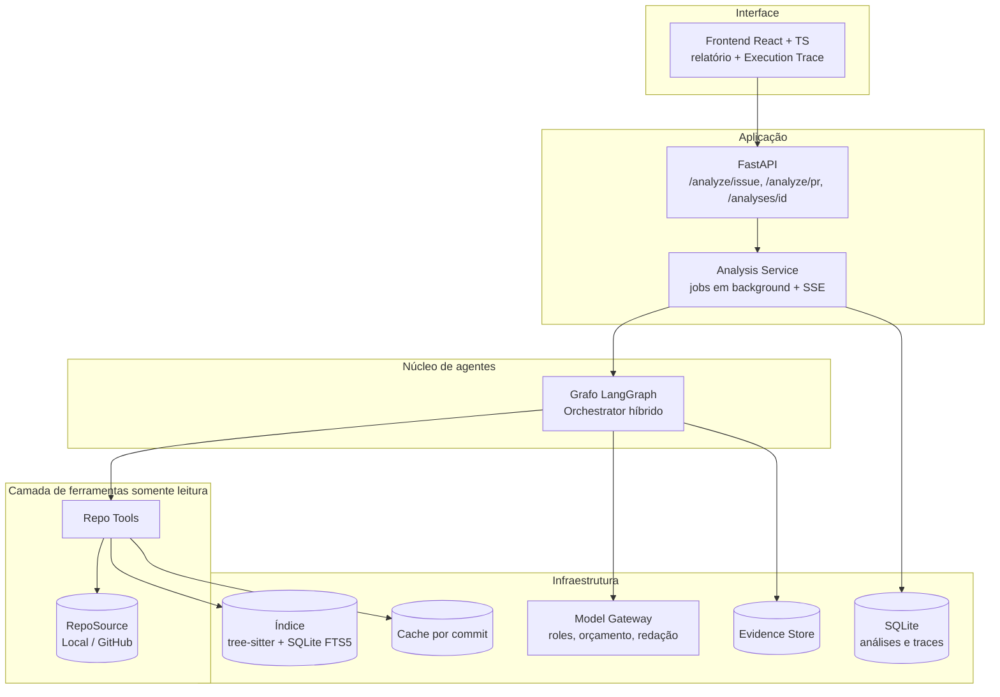
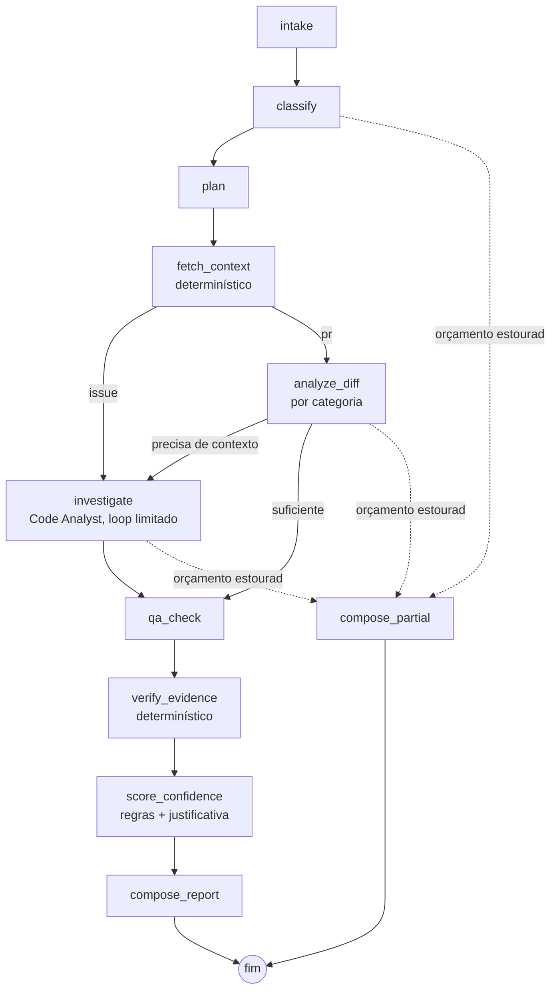

# DevLens — 03. Arquitetura

> Documentação do DevLens, etapa 3 de 8. Índice em [README.md](README.md).

## 1. Visão em camadas



Regra de dependência: cada camada só conhece a de baixo. O grafo nunca acessa
disco, Git ou rede diretamente; só via ferramentas e Model Gateway.

## 2. Componentes

| Componente | Responsabilidade |
|---|---|
| Frontend | Submeter análise, exibir trace em árvore (via SSE) e relatório com links para evidências |
| API (FastAPI) | Validar entrada, criar análise, expor status/resultado/trace |
| Analysis Service | Executar o grafo como tarefa assíncrona, persistir eventos, aplicar orçamento |
| Grafo (LangGraph) | Orquestração híbrida: etapas determinísticas + loop de investigação limitado |
| Repo Tools | Interface única de ferramentas (busca, leitura por trecho, símbolos, histórico, testes) |
| RepoSource | Abstração da fonte: `LocalRepoSource` (git + arquivos) e `GitHubRepoSource` (API, leitura) |
| Índice | Símbolos, imports e chamadas (tree-sitter para Python e JS/TS) + busca textual BM25 (SQLite FTS5), indexado por commit |
| Evidence Store | Guarda evidências com referência, trecho curto e status de verificação |
| Model Gateway | Único ponto de acesso a LLMs: escolha de modelo por papel, contagem de tokens/custo, redação de segredos, cache de prompt quando suportado |
| Persistência | SQLite: análises, eventos de trace, evidências, achados, execuções de avaliação |

## 3. Grafo do Orchestrator (híbrido)



**Onde o LLM decide:** `classify`/`plan` (plano curto e estruturado),
`analyze_diff`, o roteamento "precisa de mais contexto?" e o loop de `investigate`.

**Onde nada é do LLM:** `fetch_context`, `verify_evidence`, `score_confidence`
(regras), controle de orçamento e arestas de falha.

**Guarda de orçamento:** verificada em toda transição. Ao estourar, vai para
`compose_partial` com o que já foi validado, indicando o que ficou de fora.

### Estado do grafo (resumo)
- `input` (tipo, referência, repositório)
- `plan` (etapas previstas)
- `budget` (limites e consumo de tokens, tool calls, passos)
- `evidence_ids` (referências, nunca texto bruto)
- `findings` (achados com evidências e categoria)
- `qa_result`
- `status` (normal, parcial, falha)

## 4. Code Analyst (loop limitado)

- Padrão ReAct com ferramentas: `search_code`, `read_range`, `find_symbol`,
  `git_log`/`git_blame`/`git_show`, `find_tests`, `related_issues` (GitHub);
  catálogo completo na etapa 5.
- Contexto isolado: recebe apenas a pergunta de investigação, resumo do
  diff/issue e orçamento restante.
- Saída estruturada (Pydantic) entregue pela ferramenta `finish_investigation`:
  hipóteses/achados + ids de evidência.
- Condições de parada: máximo de passos, detecção de repetição (mesma
  ferramenta + mesmos argumentos), evidência suficiente ou orçamento.

## 5. Evidências e verificação

Evidência = `{id, repo, commit, kind(code|commit|issue|test), path,
line_start, line_end, snippet_hash, excerpt, verified, verification_note}`.

Verificação (sem LLM): lê o arquivo no commit indicado, confere que as
linhas existem e que o hash do trecho bate. Falhou: o achado é descartado ou
rebaixado e o motivo vai para o trace.

Confiança (regra detalhada na etapa 4):
- **Alta:** pelo menos 2 evidências verificadas de tipos independentes, sem contradição.
- **Média:** 1 evidência forte ou 2 do mesmo tipo.
- **Baixa:** evidência indireta ou parcialmente verificada.
A justificativa lista as evidências usadas.

## 6. Model Gateway

- Interface própria `ModelGateway.invoke(role, messages, schema)`.
- Papéis: `triage` (barato/local), `analysis`, `synthesis` (mais forte).
- Adaptadores via classes de chat model do LangChain (nuvem e Ollama/local).
- Responsabilidades transversais: contagem de tokens e custo por chamada,
  redação de segredos na entrada, bloqueio de nuvem em modo local-only,
  registro no trace.

## 7. Fluxos principais

**Issue:** intake → classify → plan → fetch_context (issue, commits recentes)
→ investigate → qa_check (testes relacionados) → verify → score → report.

**PR:** intake → classify → plan → fetch_context (diff, arquivos alterados,
testes) → analyze_diff por categoria → (investigate se faltar contexto)
→ qa_check → verify → score → report.

## 8. Economia de contexto na arquitetura
- Índice local resolve busca e símbolos sem LLM.
- Ferramentas devolvem trechos limitados; evidências viajam por id.
- Cache de ferramentas por hash de commit.
- Sub-agente com contexto isolado; Orchestrator só vê resumos estruturados.
- Modelos por papel; trace registra custo por passo.

## 9. Segurança por camada
| Camada | Controle |
|---|---|
| Entrada/API | Validação por esquema; limites de tamanho; allowlist de repositórios |
| Ferramentas | Somente leitura; sem shell; normalização de caminhos (anti path traversal) |
| Conteúdo analisado | Tratado como dado; delimitado nos prompts; nunca interpretado como instrução |
| Model Gateway | Redação de segredos; modo local-only; aviso de envio a terceiros |
| Credenciais | Token do GitHub com escopo mínimo via variável de ambiente; fora de logs e trace |
| Persistência | Excerpts curtos; sem segredos; logs sem trechos completos |

Detalhes e modelo de ameaças na etapa 6.

## 10. Decisões arquiteturais (resumo)
| # | Decisão | Motivo | ADR |
|---|---|---|---|
| 1 | Escopo A+C: Issue Investigator e PR Review sobre a mesma base | Menos saturado e demonstra tudo com profundidade | [0001](adr/0001-escopo-issue-e-pr.md) |
| 2 | LangGraph, com modelo atrás de interface própria | Multi-agente com estado e trace; sem ficar preso a um provedor | [0002](adr/0002-langgraph-e-modelo-agnostico.md) |
| 3 | Grafo híbrido em LangGraph | Agência controlada, trace natural | [0003](adr/0003-orquestrador-hibrido.md) |
| 4 | Verificação de evidência sem LLM e confiança por regras | Confiabilidade e custo zero de tokens | [0004](adr/0004-verificacao-de-evidencia-e-confianca.md) |
| 5 | Índice local (tree-sitter + FTS5) em vez de embeddings no MVP | Simples, barato, determinístico | [0005](adr/0005-indice-local-sem-embeddings.md) |
| 6 | SQLite + jobs assíncronos em processo + SSE para o trace | Mínima infraestrutura para uma pessoa | [0006](adr/0006-sqlite-jobs-em-processo-e-sse.md) |
| 7 | Local-first, com modo local-only de dupla barreira | Privacidade como requisito desde o início | [0007](adr/0007-local-first-e-modo-local-only.md) |
| 8 | `snippet_hash` como HMAC com chave local | Evita reverter segredos curtos a partir do hash | [0008](adr/0008-snippet-hash-como-hmac.md) |

## 11. Estrutura de repositório (proposta)
```
devlens/
  backend/
    app/api/            # rotas FastAPI
    app/service/        # Analysis Service, jobs, SSE
    app/graph/          # nós, estado, arestas LangGraph
    app/agents/         # Code Analyst, prompts, esquemas
    app/tools/          # Repo Tools + RepoSource (local, github)
    app/index/          # tree-sitter, FTS5
    app/evidence/       # store, verificação, confiança
    app/gateway/        # Model Gateway, redação, orçamento
    app/db/             # modelos e migrações
    tests/
  frontend/             # React + TS
  eval/                 # casos de avaliação e runner
  docs/                 # esta documentação
  docker-compose.yml
```

## 12. Riscos e pontos em aberto
- **Modelos locais pequenos têm tool calling fraco:** mitigar com saídas
  estruturadas, loop curto e ferramentas de poucos parâmetros; spike no início
  da fase 2 do roadmap.
- Regra de confiança e esquemas: etapa 4. Técnica de redação de segredos:
  etapa 6. Escopo do frontend e cronograma: etapa 8.
