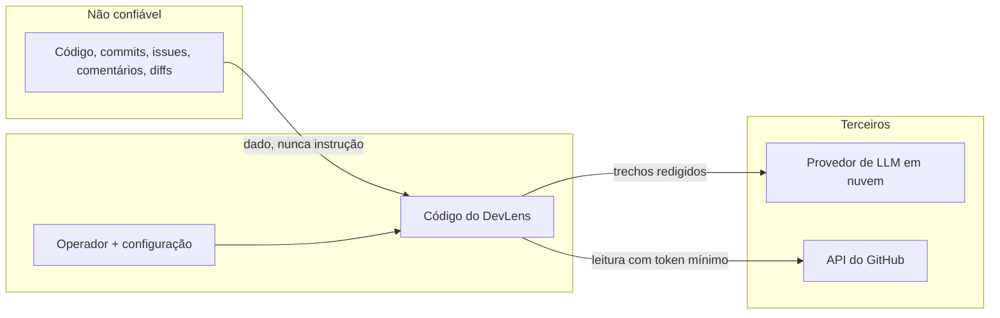

# DevLens — 06. Segurança e Threat Model

> Documentação do DevLens, etapa 6 de 8. Índice em [README.md](README.md).

Escopo: segurança do DevLens como aplicação e como sistema com LLM. É um
projeto local-first de portfólio, então o modelo assume um operador único
confiável e foca nos riscos reais: conteúdo hostil analisado, vazamento de
código e segredos, e abuso de custo.

## 1. Ativos a proteger

| Ativo | Por que importa |
|---|---|
| Código-fonte analisado | Pode ser privado; trechos saem da máquina em modo nuvem |
| Segredos dentro do código (chaves, tokens, senhas) | Vazariam para provedor, banco, logs e trace |
| Credenciais do DevLens (token GitHub, chaves de provedores) | Acesso a repositórios e custo financeiro |
| Integridade do relatório | Um achado falso ou manipulado engana o usuário |
| Orçamento (tokens e custo) | Pode ser drenado por entrada maliciosa |
| Máquina do operador | Não pode ser alvo via código analisado |

## 2. Fronteiras de confiança

Regra central: **tudo que vem do repositório é dado hostil por padrão**,
inclusive quando o repositório é do próprio usuário (dependências, PRs
externos e issues abertas por terceiros).

## 3. Modelo de ameaças

| # | Ameaça | Vetor | Impacto | Controles principais |
|---|---|---|---|---|
| T1 | Prompt injection direta e indireta | Instruções em código, comentário, issue, PR ou mensagem de commit | Achados manipulados, ferramentas mal usadas, exfiltração | Seção 4 |
| T2 | Vazamento de segredos para o provedor | Segredo hardcoded em trecho enviado ao LLM | Comprometimento de credenciais | Redação (seção 5) |
| T3 | Persistência de segredos | Excerpts, logs, trace, cache, dumps | Vazamento em repouso | Redação antes de persistir, retenção (seção 7) |
| T4 | Path traversal e leitura fora do repo | Argumentos de ferramenta, links simbólicos | Leitura de arquivos do host | Normalização, allowlist, bloqueio de symlinks (etapa 5) |
| T5 | Execução de código ou comandos | Argumentos maliciosos em chamadas git, scripts do repo | Controle da máquina | Sem shell, sem executar o código analisado, git por biblioteca, hooks e configs do repo desabilitados (seção 6) |
| T6 | Exfiltração via saída renderizada | Modelo induzido a gerar link ou imagem remota no relatório | Dados em URL de terceiros | Frontend não carrega recursos remotos (seção 4) |
| T7 | Negação de serviço e custo | Repositório enorme, issue gigante, loops | Custo e travamento | Orçamento, limites de tamanho, timeouts (seção 8) |
| T8 | Evidência falsa ou desatualizada | Alucinação, injeção | Relatório enganoso | Verificação determinística no commit fixado |
| T9 | Abuso da API | Acesso de outra origem ou máquina | Uso indevido do token e do orçamento | Bind local, chave de API, CORS restrito (seção 9) |
| T10 | Cadeia de suprimentos | Dependências comprometidas | Execução no host | Versões fixas, auditoria, imagem mínima (seção 10) |
| T11 | Vazamento por terceiros | Retenção ou treino no provedor | Código fora do controle | Aviso explícito, modo local-only, escolha de provedor (seção 6) |
| T12 | SSRF | URLs controladas pelo usuário ou pelo conteúdo | Acesso a rede interna | Sem busca de URLs arbitrárias, só host do GitHub (seção 6) |

## 4. Prompt injection (T1, T6, T8)

Não existe defesa perfeita; a estratégia é **reduzir o raio de explosão** e
não confiar em instruções ao modelo como única barreira.

1. **Capacidade mínima:** todas as ferramentas são somente leitura e sem
   rede de saída. Mesmo um modelo totalmente induzido só consegue ler trechos
   do repositório permitido e produzir texto estruturado.
2. **Delimitação:** conteúdo do repositório entra em blocos delimitados por um
   marcador **aleatório por análise** (nonce), que o conteúdo não consegue
   prever nem fechar. O prompt de sistema declara que o bloco é dado.
3. **Saída estruturada:** o agente só devolve o esquema Pydantic. Texto fora do
   esquema é descartado.
4. **Sem confiança no modelo para o que é decisão de segurança:** confiança,
   status e validade das evidências são definidos por código (etapa 4).
   Uma injeção bem-sucedida pode propor um achado, mas ele só sobrevive com
   evidências que existem de fato no commit.
5. **Detecção leve:** padrões típicos de injeção ("ignore as instruções",
   "system prompt", pedidos para chamar ferramentas) em conteúdo do
   repositório geram um evento `error` de aviso no trace e uma nota no
   relatório. É sinal para o usuário, não bloqueio.
6. **Renderização segura no frontend:** o relatório é renderizado como texto
   escapado ou Markdown sanitizado. Sem imagens e sem links remotos
   carregados automaticamente; links só para evidências internas e, no GitHub,
   para o domínio do próprio repositório.
7. **Teste adversarial:** o conjunto de avaliação (etapa 7) inclui casos com
   injeção em comentário, issue e commit, e mede se o relatório resiste.

## 5. Redação de segredos (T2, T3)

Executada no Model Gateway e no wrapper de ferramentas, **antes** de enviar ao
LLM e **antes** de persistir qualquer excerpt.

**Técnica em camadas:**
1. **Regras por padrão conhecido:** chaves de provedores, tokens do GitHub,
   chaves privadas PEM, JWT, strings de conexão com senha, URLs com
   credenciais. Lista versionada no repositório, com testes por regra.
2. **Contexto por nome de variável:** atribuições a nomes como `password`,
   `secret`, `token`, `api_key`, `private_key` têm o valor redigido.
3. **Entropia:** strings longas de alta entropia em contexto suspeito, com
   limiar ajustável para equilibrar falso positivo e falso negativo.
4. **Arquivos sensíveis:** `.env*`, `*.pem`, `*.key`, `id_rsa*`, arquivos de
   credenciais de nuvem não são lidos pelas ferramentas (retornam
   `PATH_DENIED`); só aparecem na lista de arquivos, sem conteúdo.

**Substituição:** o valor vira `[REDACTED:<tipo>]`, preservando linhas e
formato, para que numeração e leitura do código continuem coerentes.

**Considerações:**
- **Hash de verificação:** `snippet_hash` é um HMAC com chave local da
  instalação, calculado sobre o trecho **original**. Hash simples de um
  segredo de baixa entropia poderia ser revertido por força bruta; com HMAC,
  isso deixa de ser possível sem a chave (ADR 0008).
- **Redação é melhor esforço, não garantia.** Está dito na documentação e na
  interface. Para código realmente sensível, a resposta correta é o modo
  local-only.
- **Achado de segurança sobre segredo:** se a redação encontra um segredo no
  repositório, isso é registrado como achado informativo ("possível segredo
  em `path:linha`", sem o valor) quando relevante à análise.

## 6. Dados enviados a terceiros e modo local-only (T11, T12)

- **O que sai da máquina em modo nuvem:** trechos redigidos de código, resumo
  de issue/PR e perguntas do agente. Nunca o repositório inteiro, nunca
  segredos conhecidos, nunca o token do GitHub.
- **Aviso explícito:** interface e `Report.notices` informam o provedor usado
  e a natureza do que foi enviado (RNF-17), antes da primeira análise e em
  cada relatório. Dependência de terceiros é premissa declarada do projeto.
- **Escolha do provedor:** a documentação recomenda verificar a política de
  retenção e de treinamento do provedor e preferir planos de API com
  retenção reduzida ou sem treino sobre dados enviados.
- **Local-only (`local_only=true`):**
  - o Model Gateway recusa qualquer adaptador que não seja local;
  - na configuração Docker, o perfil `local-only` roda o backend em rede
    interna sem rota de saída, de modo que o bloqueio não depende só do código;
  - a análise falha com erro claro se não houver modelo local configurado.
- **Rede de saída do backend:** apenas hosts configurados (provedor escolhido
  e `api.github.com`). Nenhuma ferramenta busca URLs arbitrárias; links dentro
  de issues e código nunca são seguidos (T12).
- **Git do repositório local:** configurações e hooks do repositório analisado
  são desabilitados nas chamadas (sem hooks, sem filtros externos, sem
  `core.fsmonitor`, sem aliases), evitando execução por configuração hostil (T5).
  Sem submódulos e sem LFS.

## 7. Retenção e dados em repouso (T3)

| Dado | Retenção padrão | Observação |
|---|---|---|
| Análises, achados, trace | 30 dias, configurável | Excerpts curtos e já redigidos |
| Evidências | Junto com a análise | `excerpt` ≤ 600 caracteres |
| `tool_cache` | 7 dias ou até a análise expirar | Resultados já redigidos |
| Índice local | Até 14 dias sem uso | Só em disco local, reconstruível |
| Logs da aplicação | 7 dias | Sem código completo e sem segredos (RNF-31) |

- Job de limpeza periódico e endpoint `DELETE /analyses/{id}` (RF-65), que
  apaga análise, trace, evidências e entradas de cache associadas.
- O banco SQLite fica em volume dedicado; o README recomenda criptografia de
  disco do sistema. Criptografia do banco fica fora do MVP.
- **Credenciais:** apenas por variáveis de ambiente ou arquivo `.env` fora do
  controle de versão, com `.env.example` sem valores. Nunca em banco, trace,
  log ou resposta de erro; as variáveis são mascaradas em qualquer dump de
  configuração.

## 8. Limites contra abuso de custo e DoS (T7)

- **Orçamento por análise** (tokens, chamadas, passos), com corte e relatório
  parcial (etapa 4).
- **Limite global:** teto de custo diário configurável (RNF-06); ao atingir,
  novas análises são recusadas com erro claro.
- **Tamanhos:** entrada de até 20.000 caracteres (contrato), diff de PR com
  limite de linhas e arquivos, arquivos acima de 1 MB ignorados, repositório
  acima do limite do MVP gera aviso e análise restrita aos arquivos alterados.
- **Concorrência:** poucas análises simultâneas (padrão: 2), fila para o resto.
- **Timeouts:** por ferramenta, por chamada de modelo e por análise total.
- **Rate limit** por IP/chave na API.

## 9. Segurança da API e do frontend (T9)

- Bind em `127.0.0.1` por padrão; expor em outra interface exige configuração
  explícita e **chave de API obrigatória** (cabeçalho), com comparação em tempo
  constante (RNF-19).
- CORS restrito à origem do frontend; sem `*`.
- Validação de entrada por Pydantic, com limites; erros sem detalhes internos
  (sem stack trace nem caminhos do host).
- Allowlist de repositórios e raízes locais permitidas, definida em
  configuração, nunca vinda do corpo da requisição.
- Cabeçalhos de segurança no frontend (CSP restritiva, sem `eval`, sem
  origens externas), sem armazenar chaves no navegador.
- SSE sem dados sensíveis além do já redigido do trace.

## 10. Cadeia de suprimentos e execução (T10)

- Dependências com versões fixas (lockfiles), auditoria automática
  (`pip-audit` e `npm audit`) e atualização monitorada no CI.
- Imagem Docker mínima, usuário não root, sistema de arquivos somente leitura
  exceto volumes de dados, sem capacidades extras.
- O código analisado é **lido, nunca executado**: sem instalar dependências do
  repositório alvo, sem rodar testes, sem importar módulos dele.
- Segredos de CI e do desenvolvimento do próprio DevLens ficam fora do
  repositório; varredura de segredos (ex.: gitleaks) no CI.

## 11. Mapeamento com os requisitos

| Requisito | Onde é tratado |
|---|---|
| RNF-06 | Seção 8 |
| RNF-10 | Seções 4 e 6 (sem shell, sem execução) |
| RNF-11 | Seção 4 |
| RNF-12 | Etapa 5 e seção 9 |
| RNF-13 | Seção 5 |
| RNF-14 | Seção 7 |
| RNF-16 | Seção 6 |
| RNF-17 | Seção 6 |
| RNF-18 | Seção 7 |
| RNF-19 | Seção 9 |
| RNF-31 | Seções 5 e 7 |
| RF-65 | Seção 7 |

## 12. Riscos residuais (aceitos e documentados)

- Redação de segredos pode falhar em formatos incomuns.
- Prompt injection sofisticada pode induzir achados enganosos; o impacto fica
  limitado pela verificação de evidências, mas não eliminado.
- Em modo nuvem, o provedor recebe trechos do código; a proteção real é
  contratual e do provedor.
- Sem multiusuário, sem isolamento entre usuários: o DevLens assume um único
  operador confiável.

## 13. Testes de segurança

- Testes unitários por regra de redação, com segredos sintéticos e casos de
  falso positivo.
- Fixture de repositório com: injeção em comentário, em issue e em mensagem de
  commit; symlink para fora; arquivo `.env`; hook git malicioso.
- Teste de contrato do modo local-only: nenhuma chamada de rede de saída.
- Teste de que logs, trace e banco não contêm os segredos sintéticos.

## 14. Pontos em aberto
- Limiar de entropia e lista final de regras de redação: calibrar com os
  casos de avaliação (etapa 7).
- Valores de retenção e limites de custo diário: ajustar após medir uso real.
- Documento `SECURITY.md` curto no repositório, resumindo esta etapa para
  leitores externos: criar junto com o README (fase 6 do roadmap).
